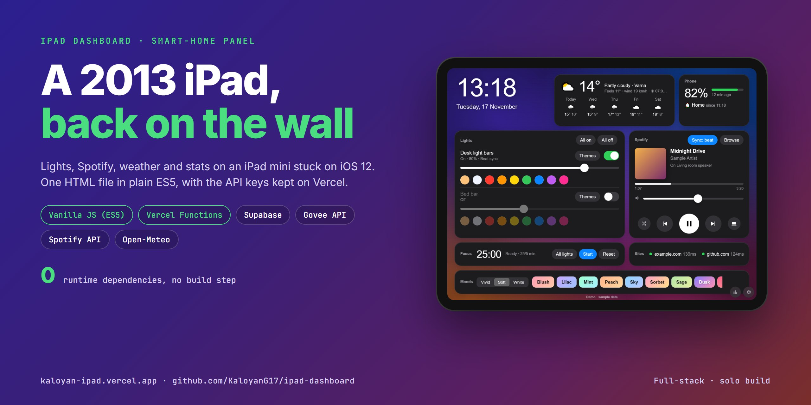
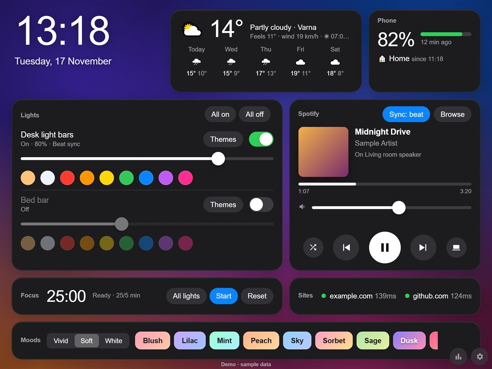
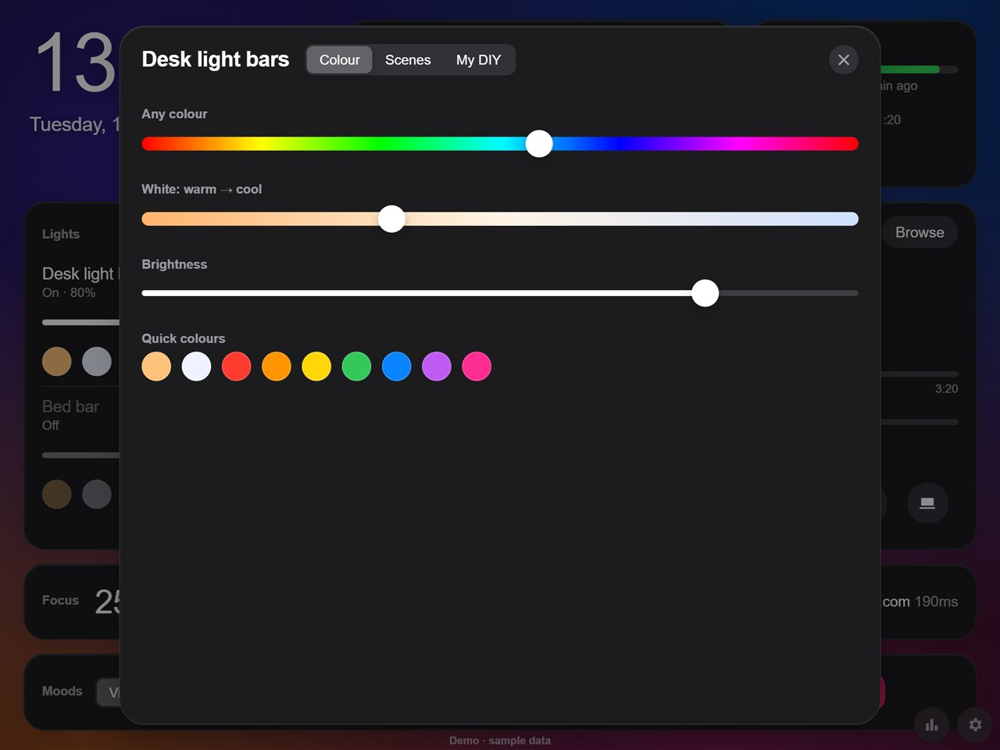
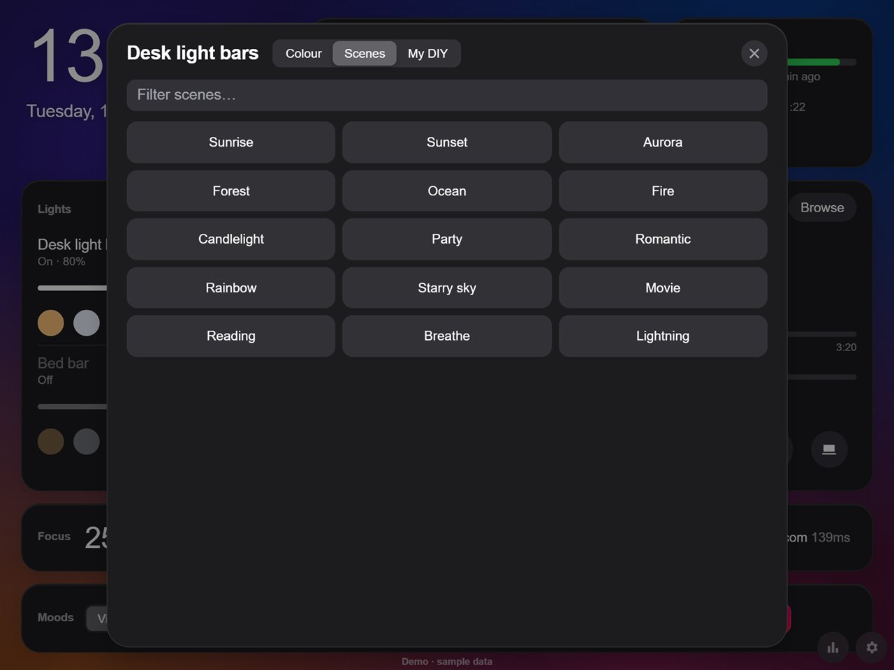
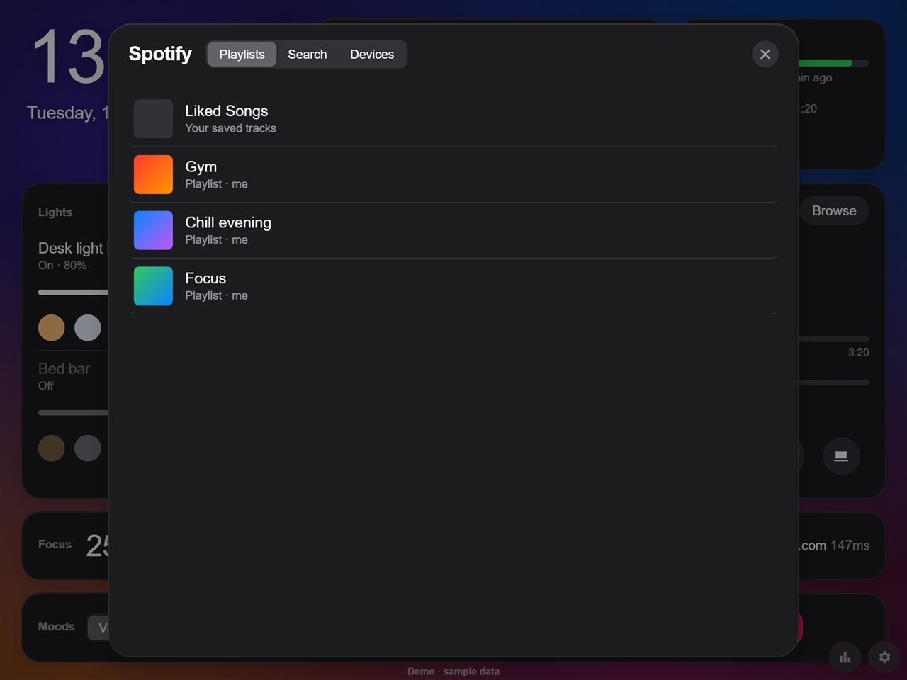
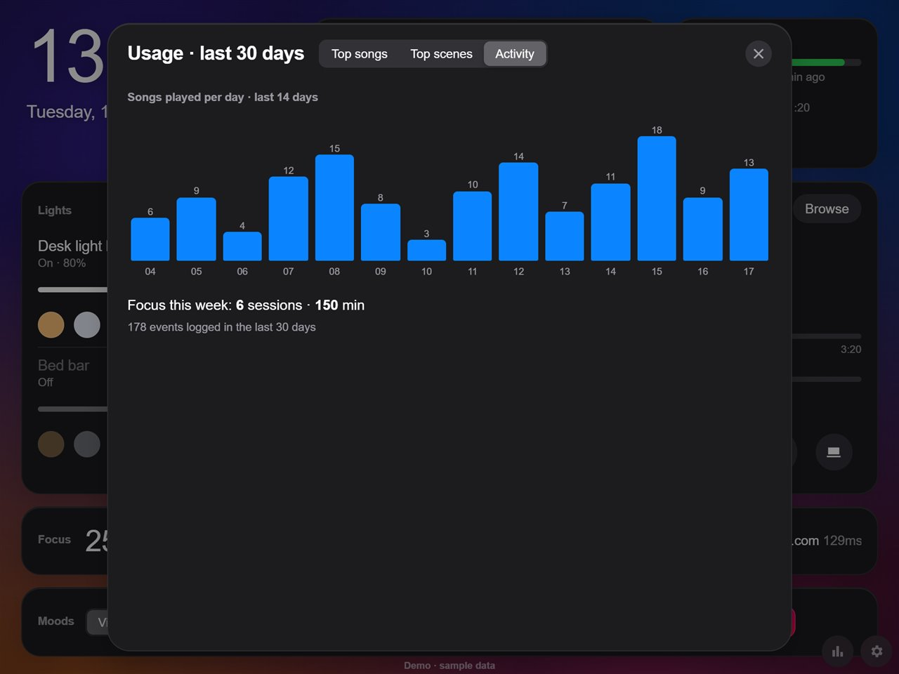
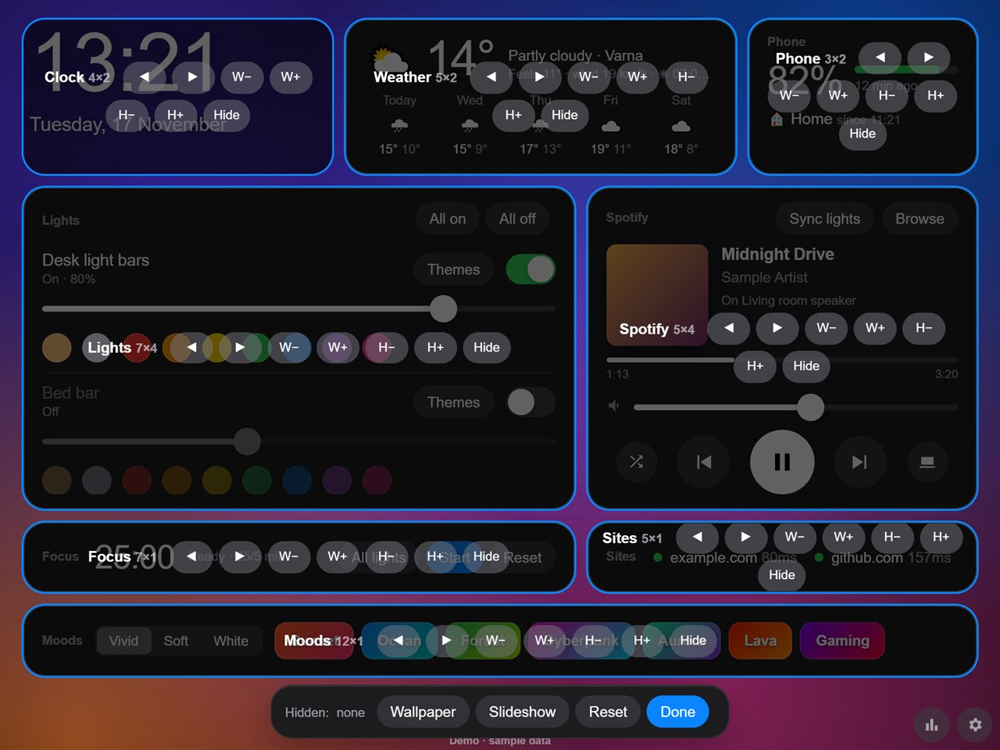
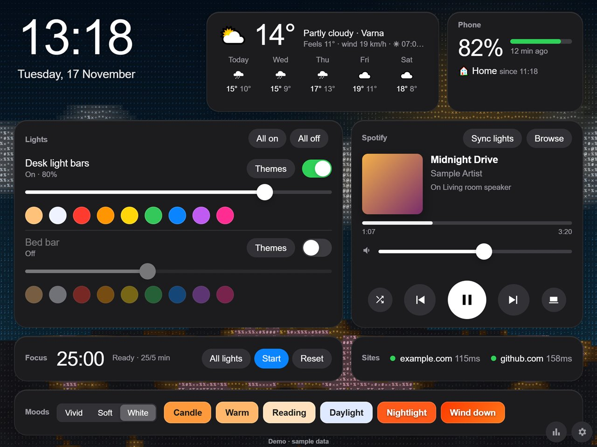
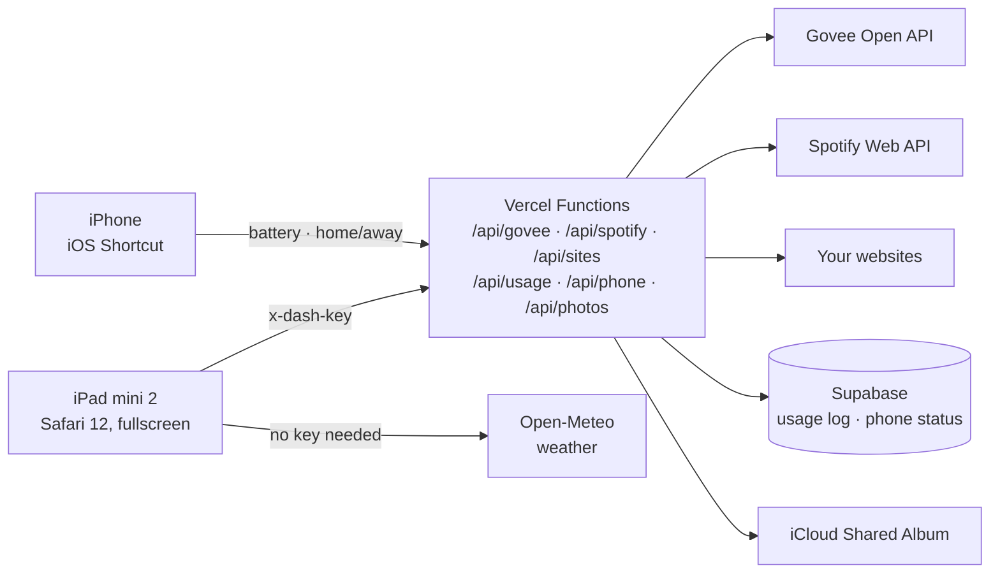

<a href="https://kaloyan-ipad.vercel.app/?demo"></a>

<p align="center">
  <a href="https://kaloyan-ipad.vercel.app/?demo"></a>
  <a href="docs/deck.pdf"></a>
  
  
  
</p>

**iPad Dashboard** turns a 2013 iPad mini into a smart-home wall panel: it controls my Govee lights, plays Spotify, makes the lights pulse to the music, and shows the weather, my phone and my websites. The iPad is stuck on iOS 12 and Safari 12, so the whole page is one HTML file in plain ES5 with no build step and no runtime dependencies.

<p align="center"><a href="https://kaloyan-ipad.vercel.app/?demo"><b>▶ Try the live demo</b></a>: it runs on sample data, every button works, and nothing touches real devices.</p>

<p align="center"><br><sub>Running on my iPad mini 2 with real lights and real Spotify playback (photographed with the first design).</sub></p>

---

## 01 · What it does



| Card | What you can do |
| --- | --- |
| **Lights** | On/off, brightness, 9 quick colours, a hue slider, warm-to-cool white, every built-in and DIY Govee scene, all on / all off |
| **Moods** | 24 one-tap colourways in three sets (Vivid, Soft, White), dealt across every light with matching brightness |
| **Spotify** | Now playing, play/pause/skip, volume, shuffle, playlists and Liked Songs, search, and moving playback to the Echo or phone |
| **Sync lights** | Off, **Colour** (lights take the album art's colour) or **Beat** (they also pulse with the music) |
| **Focus** | A 25/5 timer that turns the lights red, then green for the break, then puts them back |
| **Weather · Phone · Sites** | 5-day forecast, phone battery and home/away from an iOS Shortcut, and uptime for my websites |
| **Stats** | Top songs, top scenes and a 14-day activity chart from a Supabase log |
| **Layout** | Move, resize and hide every card on the iPad; after 5 idle minutes it becomes an iCloud photo frame |

| Colour | Scenes | Spotify |
| --- | --- | --- |
|  |  |  |
| **Usage stats** | **Edit layout** | **Text-art wallpaper** |
|  |  |  |

## 02 · Building for Safari 12

A single unsupported feature (optional chaining, `??`, flexbox `gap`, `ResizeObserver`) stops the whole page on iOS 12, so [`index.html`](index.html) is written in plain ES5 with no framework and no build step.

- **Layout without modern APIs.** Cards sit on a 12-column CSS grid; with no `ResizeObserver`, [`markCompact()`](index.html#L500) checks each card's overflow and hides its extras only when they really don't fit.
- **iOS look in plain CSS.** System colours, translucent `-webkit-backdrop-filter` materials, iOS switches, segmented controls and sliders whose track fills up to the thumb ([`fillRange()`](index.html#L472)).
- **No image assets.** Both wallpapers are drawn on a canvas: a soft colour mesh ([`drawMesh()`](index.html#L437)) or a landscape made of text characters from value noise.

## 03 · Lights that follow the music

- **Album colour.** [`artColour()`](index.html#L850) draws the cover art onto a 24×24 canvas and weights colourful pixels over grey ones, so the lights get the album's real accent colour, not a muddy average.
- **Beat sync.** Spotify gives new apps no loudness or beat data, and Govee's cloud is too slow to send beats, so the dashboard switches on the bars' **own microphone mode** in the album colour. The mode's id differs per light model, so [`beatMode()`](index.html#L875) finds "Beat" by name in the capabilities each light reports.
- **Rate limits.** Govee allows few calls a day, so device and scene lists are cached in [`api/govee.js`](api/govee.js), states are polled once a minute, and after a change the page [keeps its own value](index.html#L689) for 10 seconds while Govee still reports the old one.

## 04 · Keys stay on the server

| What | How it's protected |
| --- | --- |
| Govee key, Spotify tokens, Supabase key | Vercel environment variables only; the iPad talks to its own `/api/*` routes |
| Every control route | Needs the dashboard key ([`denied()`](api/_lib.js#L5)) |
| Commands from the page | Matched against an allow-list ([`command()`](api/spotify.js#L119), [`capability()`](api/govee.js#L19)) before anything goes upstream |
| Spotify login | OAuth refresh token, swapped for short-lived access tokens on the server |
| Supabase tables | [Row-level security with no policies](supabase.sql#L21), so only the server's secret key can read or write |
| Two screens reporting one song | A 10-minute dedupe key and a unique index drop the copy ([`log()`](api/_lib.js#L48)) |

## 05 · Architecture



| Path | What it is |
| --- | --- |
| [`index.html`](index.html) | The whole dashboard: layout, UI, wallpapers, demo mode (1,130 lines) |
| [`api/govee.js`](api/govee.js) | Lights: state, control, scenes, music mode |
| [`api/spotify.js`](api/spotify.js) | Playback, browsing, OAuth login |
| [`api/usage.js`](api/usage.js) | Usage log and stats |
| [`api/phone.js`](api/phone.js) | Phone battery and home/away |
| [`api/photos.js`](api/photos.js) | Photo list from an iCloud Shared Album |
| [`api/sites.js`](api/sites.js) | Uptime checks |
| [`api/_lib.js`](api/_lib.js) | Dashboard-key check and database helper |
| [`supabase.sql`](supabase.sql) | The two database tables |
| [`test.js`](test.js) | 50 assert-based self-checks for the server code |
| [`dev.js`](dev.js) | Local server that runs `api/*` the way Vercel does |
| [`local-claude/`](local-claude/) | The first version: a LAN-only dashboard for Claude Code token usage |

Pushing to `main` deploys to Vercel automatically.

## 06 · Stack

| Layer | Tools |
| --- | --- |
| Page | HTML, ES5 JavaScript, CSS grid, Canvas, no framework, no build step |
| Server | Vercel Functions (Node 24, Web `Request`/`Response`), 0 runtime dependencies |
| Data | Supabase (Postgres with row-level security) |
| Services | Govee Open API, Spotify Web API, Open-Meteo, iCloud Shared Albums |

## 07 · Run it locally

```bash
npm run dev    # then open http://localhost:3000/?demo
npm test       # 50 self-checks
```

Node 20 or newer, nothing to install. Demo mode runs entirely in the page, so it needs no keys.

<details>
<summary><b>Set it up for real</b></summary>

1. Fork this repo and import it into [Vercel](https://vercel.com/new).
2. Add these environment variables in Vercel → Settings → Environment Variables (see [`.env.example`](.env.example)):

   | Variable | What it is |
   |---|---|
   | `DASH_KEY` | Any long random string. It's the password in your dashboard URL. |
   | `GOVEE_API_KEY` | Govee Home app → Profile → ⚙ → Apply for API Key |
   | `SPOTIFY_CLIENT_ID` / `SPOTIFY_CLIENT_SECRET` | From an app at developer.spotify.com. Set its redirect URI to `https://<your-site>/api/spotify` |
   | `SPOTIFY_REFRESH_TOKEN` | Deploy once, open `https://<your-site>/api/spotify?login`, and paste the token it shows |
   | `SITES` | Comma-separated URLs to monitor |
   | `SUPABASE_URL` / `SUPABASE_SECRET_KEY` | Optional, for stats and phone status. Run [`supabase.sql`](supabase.sql) in the SQL Editor, then copy the URL and the **secret** key from Settings → API Keys |
   | `ICLOUD_ALBUM` | Optional, for the photo frame. Make a Shared Album in Photos, turn on **Public Website**, and paste its link |

3. Change `CITY` near the bottom of `index.html` to your city.
4. On the iPad, open `https://<your-site>/?key=<DASH_KEY>` in Safari, then **Share → Add to Home Screen**. Turn Auto-Lock off and use Guided Access to lock the iPad to the dashboard.

Playback control needs Spotify Premium; now playing works on free accounts.

**Phone status (iOS Shortcut).** In the Shortcuts app, make one automation per report, each a single **Get Contents of URL** action: URL `https://<your-site>/api/phone`, method POST, header `x-dash-key` = your `DASH_KEY`, JSON body:

| Automation trigger | JSON fields |
|---|---|
| Battery Level | `battery` = *Battery Level*, `charging` = *Is Charging* |
| Arrive at Home | `event` = `home` |
| Leave Home | `event` = `away` |

Turn off "Ask Before Running" so they run on their own.

</details>

---

<p align="center"><sub>Designed and built by <a href="https://github.com/KaloyanG17">Kaloyan Gaydarov</a> · <a href="https://www.linkedin.com/in/kaloyan-gaydarov/">LinkedIn</a> · <a href="LICENSE">MIT licence</a></sub></p>
