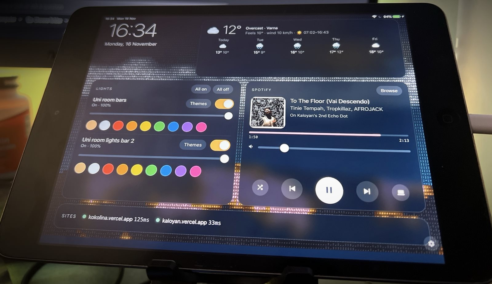
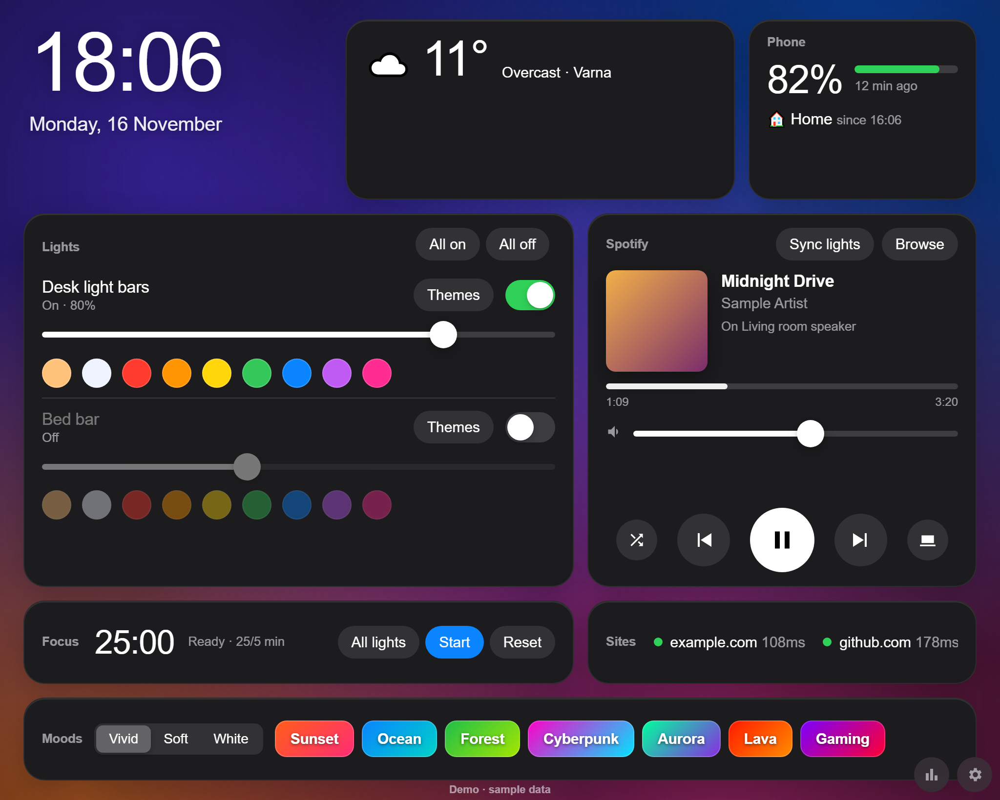
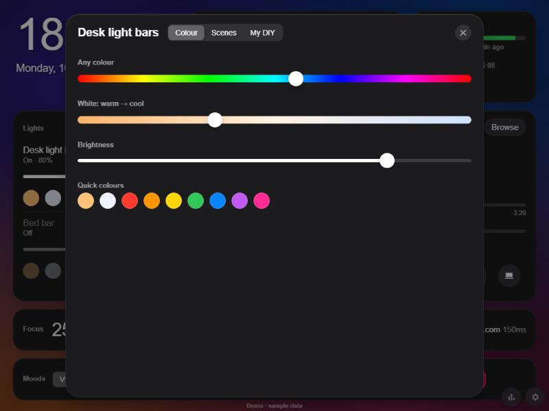
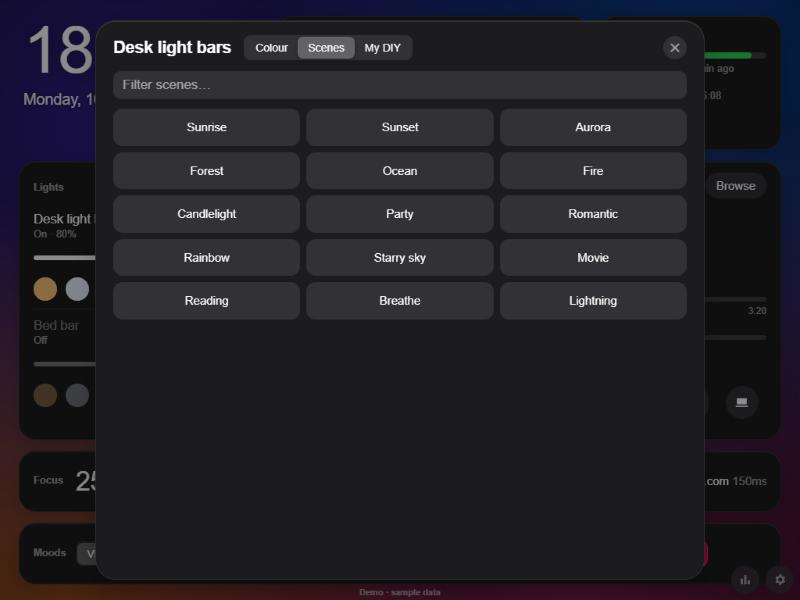
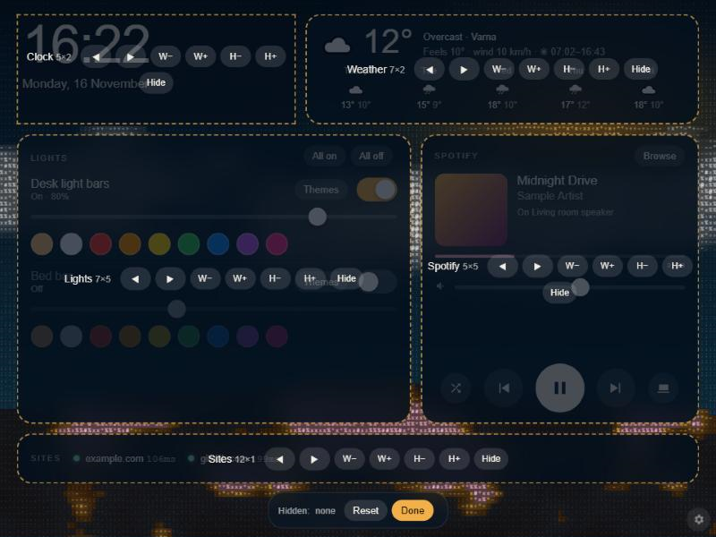
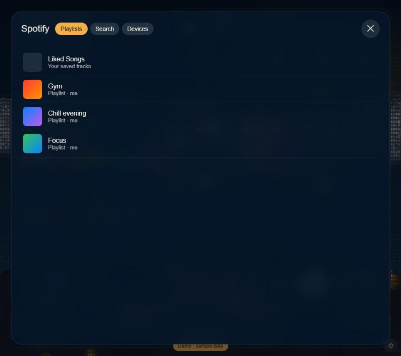
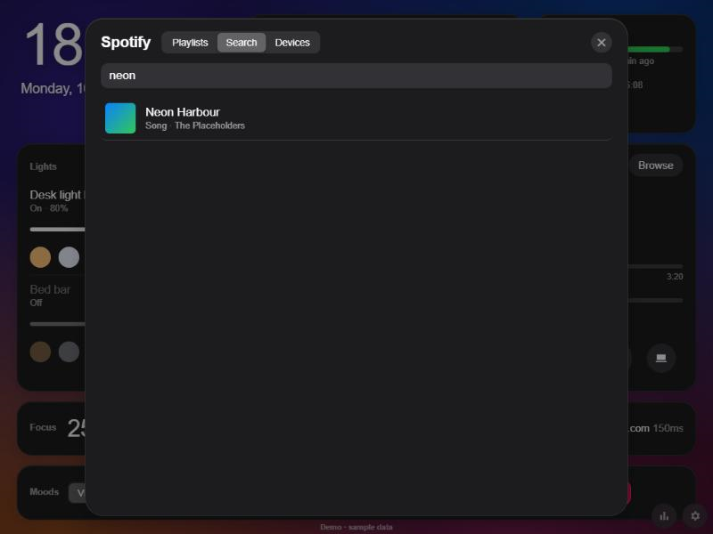
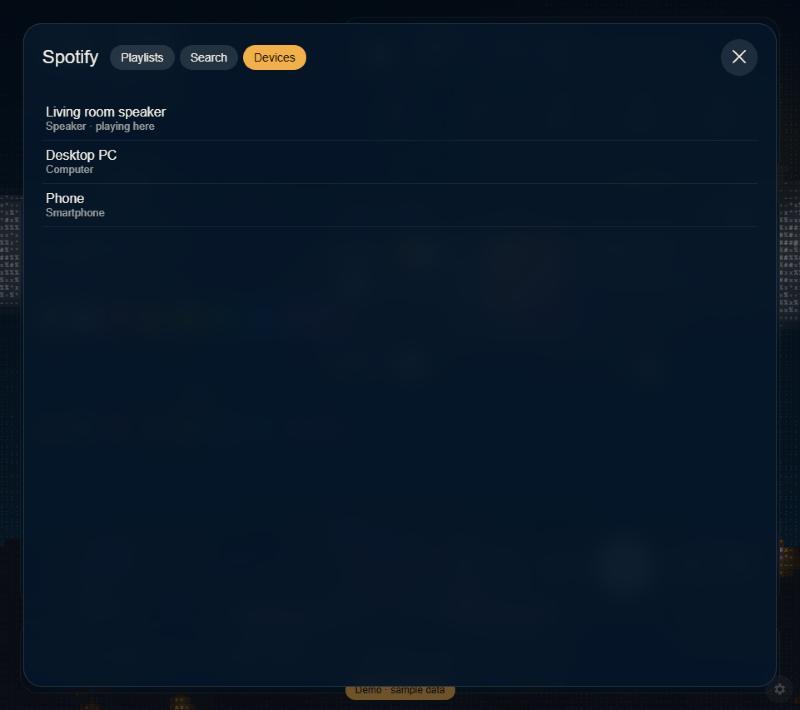

# iPad Dashboard

**Turning a 2013 iPad mini that Apple stopped updating years ago into a smart-home wall panel.**


<sub>Running on my iPad mini 2, with real lights, real Spotify playback on an Echo Dot, and live weather.</sub>

The iPad mini 2 is stuck on iOS 12 and Safari 12. Most modern web apps, and the official apps for my lights and music, no longer run on it. So I built a dashboard that does: it controls my Govee lights, browses and plays Spotify, and shows the weather and whether my websites are up. It runs fullscreen from the iPad's Home Screen, and the backend runs serverless on Vercel.

### ▶ [Try the live demo](https://kaloyan-ipad.vercel.app/?demo)

It runs on sample data: every button works, and nothing touches real devices.



| Any colour, warm/cool white | Govee scenes | Resizable layout |
|---|---|---|
|  |  |  |
| **Your playlists** | **Search** | **Move playback between devices** |
|  |  |  |

## Features

- **Govee lights:** on/off, brightness, quick colours, any colour from a hue slider, warm/cool white, every built-in scene and your own DIY scenes, and all-on/all-off.
- **Spotify:** now playing with album art and live progress, play/pause/skip, volume, shuffle, your playlists and Liked Songs, search, and moving playback between devices (phone, PC, Echo…).
- **Weather:** current conditions plus a 5-day forecast from Open-Meteo, with no API key.
- **Uptime:** a live up/down status and response time for any list of websites.
- **Moods:** thirteen one-tap colourways (Sunset, Ocean, Cyberpunk, Candle…) that deal their colours out across all the lights and set the brightness to match.
- **Lights follow the music:** one tap and the lights take the dominant colour of the current album art, worked out on a canvas in the page.
- **Focus timer:** a 25/5 Pomodoro timer that turns the lights red while you focus and green on the break, then puts them back the way they were.
- **Phone status:** an iOS Shortcut reports the phone's battery level and when you arrive home or leave.
- **Photo frame:** after five idle minutes the dashboard becomes a slideshow of an iCloud Shared Album, with the clock on top. Tap to return.
- **Usage stats:** every song played, scene picked and focus session finished is logged to a Supabase (Postgres) database; a stats page shows top songs, top scenes and a 14-day activity chart.
- **Customisable layout:** move, resize and hide every card on the iPad itself. The layout is saved on the device, and cards hide their extras automatically when they get small.
- **Generated background:** a landscape drawn entirely from text characters on a canvas, created procedurally with value noise, so there are no image assets.

## How it works


- **The page is one HTML file** with no framework and no build step. It's written in plain ES5 because Safari 12 can't run optional chaining, `??`, flexbox `gap` and similar newer features, and a single one of them breaks the whole page.
- **Secrets never reach the browser.** The Govee key and the Spotify credentials live in Vercel environment variables. The iPad only talks to my own `/api/*` routes, which check a dashboard key before they control anything.
- **Spotify uses OAuth with a refresh token.** A one-time `/api/spotify?login` flow produces it, and the server swaps it for short-lived access tokens and caches them.
- **The Govee API is rate-limited per day**, so the device list and scene lists are cached, and light states are polled once a minute. After you change a light, the UI keeps its own value for a few seconds, because Govee still reports the old state briefly.
- **Every action is checked on the server.** Spotify URIs, device IDs and Govee commands are matched against an allow-list before anything is sent upstream.
- **The database is locked down.** Both Supabase tables have row-level security on with no policies, so only the server's secret key can touch them. Two screens showing the dashboard report the same song, so each song event carries a 10-minute dedupe key and a unique index drops the copy.
- **Deployment:** pushing to `main` deploys to Vercel automatically.

## Run it yourself

### Try the UI with sample data (no accounts needed)

```bash
npm run dev
```

Open http://localhost:3000/?demo. Node 20 or newer is needed; there are no dependencies to install. Demo mode runs entirely in the page, so it works the same on the live site.

### Set it up for real

1. Fork this repo and import it into [Vercel](https://vercel.com/new).
2. Add these environment variables in Vercel → Settings → Environment Variables:

   | Variable | What it is |
   |---|---|
   | `DASH_KEY` | Any long random string. It's the password in your dashboard URL. |
   | `GOVEE_API_KEY` | Govee Home app → Profile → ⚙ → Apply for API Key |
   | `SPOTIFY_CLIENT_ID` / `SPOTIFY_CLIENT_SECRET` | From an app at developer.spotify.com. Set its redirect URI to `https://<your-site>/api/spotify` |
   | `SPOTIFY_REFRESH_TOKEN` | Deploy once, open `https://<your-site>/api/spotify?login`, and paste the token it shows |
   | `SITES` | Comma-separated URLs to monitor |
   | `SUPABASE_URL` / `SUPABASE_SECRET_KEY` | Optional, for usage stats and phone status. Create a free Supabase project, run [`supabase.sql`](supabase.sql) in its SQL Editor, then copy the project URL and the secret key from Settings → API Keys |
   | `ICLOUD_ALBUM` | Optional, for the photo frame. In Photos, make a Shared Album, turn on **Public Website**, and paste its link |

3. Change `CITY` near the bottom of `index.html` to your city.
4. On the iPad, open `https://<your-site>/?key=<DASH_KEY>` in Safari, then **Share → Add to Home Screen**. Turn Auto-Lock off, and use Guided Access to lock the iPad to the dashboard.

Playback control needs Spotify Premium; now playing works on free accounts.

### Phone status (iOS Shortcut)

In the Shortcuts app on your iPhone, make an automation for each report. Each one is a single **Get Contents of URL** action:

- **URL:** `https://<your-site>/api/phone`
- **Method:** POST
- **Headers:** `x-dash-key` = your `DASH_KEY`
- **Request Body:** JSON, with the fields from the table

| Automation trigger | JSON fields |
|---|---|
| Battery Level (e.g. every change, or a time of day) | `battery` = *Battery Level*, `charging` = *Is Charging* (both from a **Get Battery Level** / **Get Device Details** action) |
| Arrive at Home | `event` = `home` |
| Leave Home | `event` = `away` |

Turn off "Ask Before Running" so they run on their own.

### Local development

```bash
cp .env.example .env.local   # fill in your values
npm run dev                  # http://localhost:3000/?key=<DASH_KEY>
npm test                     # self-checks for the API validation
```

## Project structure

```
index.html        the whole dashboard: layout, UI, background renderer
api/govee.js      lights: state, control, scenes
api/spotify.js    playback, browsing, OAuth login
api/sites.js      uptime checks
api/usage.js      usage log and stats (Supabase)
api/phone.js      phone battery and presence, reported by an iOS Shortcut
api/photos.js     photo list from an iCloud Shared Album
supabase.sql      the two database tables
api/_lib.js       shared dashboard-key check and database helper
dev.js            local server that runs api/* like Vercel does
test.js           assert-based self-checks
local-claude/     the first version: a LAN-only dashboard for Claude Code token usage
```

## License

[MIT](LICENSE)
